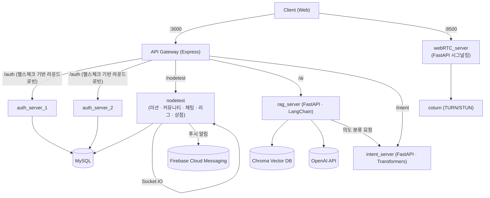

# 🎯 Challenge Up

> 공유 기반 미션으로 함께 성장하는 자기개발 커뮤니티 앱

미션을 만들고 인증하며, 같은 목표를 가진 사람들과 커뮤니티에서 소통하고, AI가 나에게 맞는 미션을 추천해주는 MSA(Micro Service Architecture) 기반 서비스입니다.


---

## 목차

1. [프로젝트 소개](#프로젝트-소개)
2. [팀 구성](#팀-구성)
3. [시스템 아키텍처](#시스템-아키텍처)
4. [기술 스택](#기술-스택)
5. [주요 기능](#주요-기능)
6. [인증 구조](#인증-구조)
7. [폴더 구조](#폴더-구조)
8. [배포 & CI/CD](#배포--cicd)
9. [로컬 실행](#로컬-실행)

---

## 프로젝트 소개

**Challenge Up**은 혼자서는 지속하기 어려운 자기개발을 "미션 인증 + 커뮤니티 + AI 추천"으로 풀어낸 서비스입니다.

- 개인 미션을 만들어 스스로 인증하거나, 오픈된 방에서 다른 사람들과 함께 미션을 수행합니다.
- 완료한 미션 데이터를 기반으로 AI가 카테고리를 분석해 다음 미션을 추천합니다.
- 주간 리그(랭킹) 시스템으로 꾸준한 참여에 동기를 부여합니다.
- 화상/음성 통화, 실시간 채팅으로 커뮤니티 구성원과 소통할 수 있습니다.

**개발 기간**: 2024.10 ~ 2025.06 (git 커밋 이력 기준)

## 팀 구성

| 이름 | 역할 |
| --- | --- |
| 김정희 | 백엔드 |
| 이준민 | 백엔드 |
| 조병욱 | 백엔드 |
| 김성훈 | 프론트엔드 |

## 시스템 아키텍처

외부에는 **API 게이트웨이 한 곳만 노출**되고, 나머지 서비스는 내부 네트워크에서만 통신합니다. (`docker-compose.yml`, `api_gateway/gateway.js` 기준)



- **API Gateway**: `http-proxy-middleware`로 각 서비스에 리버스 프록시. 인증 서버는 `/healthz`를 주기적으로 체크해 살아있는 서버로만 라우팅(장애 시 자동 failover).
- **auth_server_1 / auth_server_2**: 동일한 코드베이스의 이중화 구성. Keycloak + JWT 기반 인증.
- **nodetest**: 메인 도메인 서버. Express + Socket.IO(`socketServer.js`를 PM2로 별도 프로세스 실행)로 미션/커뮤니티/채팅/리그/상점을 처리.
- **rag_server / intent_server**: 사용자의 미션 이력을 분석해 맞춤 미션을 추천하는 AI 파이프라인 (Python/FastAPI).
- **webRTC_server**: 화상/음성 통화를 위한 시그널링 서버 + coturn TURN 서버. 게이트웨이를 거치지 않고 별도 포트로 직접 통신.
- **bpfdoor**: eBPF(libbpf) 기반 syscall(execve/connect) 트레이싱 도구. 서비스 트래픽과는 별개로, 호스트 관측/보안 모니터링 용도로 포함된 운영 도구입니다.

## 기술 스택

| 영역 | 스택 |
| --- | --- |
| Backend | Node.js, Express, Sequelize, MySQL2, Socket.IO, JWT, Keycloak-connect, node-cron, Winston |
| AI | Python, FastAPI, LangChain, Chroma, HuggingFace Transformers, PyTorch, OpenAI API, scikit-learn |
| Realtime / Media | Socket.IO, WebSocket, WebRTC 시그널링, coturn(TURN/STUN) |
| Infra | Docker, Docker Compose, GitHub Actions, AWS (S3, CodeDeploy, EC2), eBPF/libbpf |
| DB | MySQL 8.0, Chroma (Vector DB) |
| Auth | Keycloak, JWT |
| Push | Firebase Admin SDK / Cloud Messaging |

## 주요 기능

- **미션 인증**: 1:1 개인 미션과 오픈(커뮤니티) 방 미션 생성/수행/인증, 마감 시간 자동 체크(cron), 미션 완료 시 연결된 커뮤니티 방 상태 자동 갱신
- **커뮤니티**: 미션/투표/일반 게시판, 댓글과 추천(좋아요), 게시판별 최신 글 모아보기
- **AI 미션 추천 챗봇**: 사용자가 최근 완료한 미션의 상위 3개 카테고리를 집계 → `intent_server`로 발화 의도 분류 → `rag_server`가 Chroma 벡터 검색 + OpenAI API로 맞춤 추천 및 답변 생성
- **실시간 채팅 & 알림**: Socket.IO 기반 채팅방, Firebase Cloud Messaging 푸시 알림
- **리그(랭킹) 시스템**: 브론즈부터 시작하는 티어제 주간 리그, LP(League Point) 기준 상위 40% 승급 / 하위 10% 강등을 스케줄러가 자동 처리
- **상점**: 포인트 기반 아이템 조회
- **화상/음성 통화**: WebRTC 시그널링 서버 + coturn TURN 서버로 NAT 환경에서도 연결 지원
- **친구 시스템**: 친구 요청/수락 등 관계 관리 (`i_friendModel`, `t_friendModel`)

## 인증 구조

- Keycloak(realm 기반) + JWT를 함께 사용하는 구조입니다.
- 인증 서버를 `auth_server_1`, `auth_server_2` 두 대로 이중화하고, API 게이트웨이가 `/healthz` 응답을 보고 정상 서버로만 트래픽을 라우팅합니다(라운드로빈 + 장애 서버 제외).
- 게이트웨이 뒤 서비스들은 JWT를 검증하는 `loginRequired` 미들웨어로 보호됩니다.

## 폴더 구조

```
.
├── api_gateway/      # 단일 진입점 API 게이트웨이 (Express, 리버스 프록시 + 정적 페이지)
├── auth_server1/     # 인증 서버 (이중화 #1) - Keycloak + JWT
├── auth_server2/     # 인증 서버 (이중화 #2)
├── nodetest/         # 메인 백엔드 - 미션/커뮤니티/채팅/리그/상점, Socket.IO
├── rag_server/       # AI 추천 챗봇 (FastAPI, LangChain, Chroma)
├── intent_server/    # 발화 의도 분류 모델 서버 (FastAPI, Transformers)
├── webRTC_server/    # 화상통화 시그널링 서버 (FastAPI) + coturn 연동
├── webrtc-server/    # WebRTC 시그널링 초기 버전 (Node.js/ws, 현재 docker-compose 미포함)
├── bpfdoor/          # eBPF 기반 syscall 트레이싱 도구 (운영 관측용)
└── docker-compose.yml
```

## 배포 & CI/CD

전체 MSA 스택은 `docker-compose.yml`로 오케스트레이션됩니다(mysql, gateway, auth_server_1/2, nodetest, rag_server, chroma, intent_server, webRTC_server, turnserver).

`nodetest`는 별도로 GitHub Actions 파이프라인이 구성되어 있습니다 (`nodetest/.github/workflows/main.yml`):

```
push to main
  → npm install
  → 코드 zip 압축 후 AWS S3 업로드
  → .env / firebase-adminsdk.json 원격 서버에 전달
  → AWS CodeDeploy 배포 트리거 (appspec.yml의 BeforeInstall → AfterInstall → ApplicationStart 훅 실행)
  → AWS EC2에 반영
```

> 배포 대상 서버 주소는 GitHub Secrets로 관리되며, 이 문서에는 별도로 기재하지 않았습니다.

## 로컬 실행

```bash
git clone <repository-url>
cd test

# 각 서비스 디렉터리에 .env 파일 준비
#  - nodetest/.env
#  - auth_server1/.env, auth_server2/.env
#  - api_gateway/.env
#  - webRTC_server/.env

docker-compose up -d --build
```

게이트웨이가 `http://localhost:3000` 으로 노출되며, 이후 `/auth`, `/nodetest`, `/ai`, `/intent`는 게이트웨이를 통해 각 내부 서비스로 프록시됩니다.
